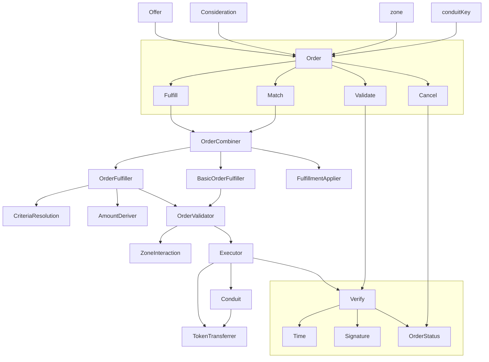
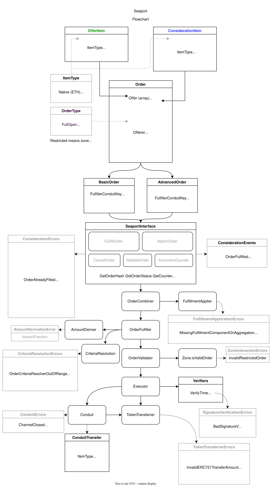

# Diagrams

## Seaport

How an order moves through the core contracts:

The full flowchart:

## Dev

To modify diagrams, open in [diagrams.net](https://diagrams.net) (formerly draw.io) and save both file and svg. Export svg with settings `Zoom: 100%` and `Border Width: 5`.